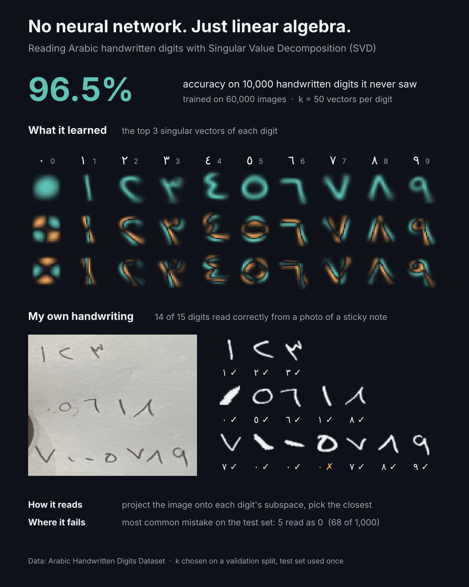

# Arabic Handwritten Digit Recognition with SVD

Reading Arabic handwritten digits (٠ to ٩) using only linear algebra. No neural network.

## Result

- **96.55% accuracy** on 10,000 test digits the model never saw
- **14 of 15** digits read correctly from a photo of my own handwriting
- Most common mistake: ٥ read as ٠ (68 of 1,000)

## How it works

1. For each digit, 6,000 training images are placed as the columns of a matrix A (784 x 6000).
2. SVD gives A = UΣVᵀ. The first k columns of U are an orthonormal basis for the subspace of that digit.
3. A new image x is projected onto each of the 10 subspaces. The digit with the smallest residual ‖x − UₖUₖᵀx‖ is the answer.
4. k is chosen on a validation split (the last 10,000 training images). The test set is used once. Best k = 50.

## Run it

1. Download the CSV files of the [Arabic Handwritten Digits Dataset](https://github.com/mloey/Arabic-Handwritten-Digits-Dataset) and unzip them into a folder named `data`.
2. Install the libraries: `pip install numpy scipy pillow matplotlib`
3. Run: `python arabic_digits_svd.py data my_digits.png`

## Try it on a new photo

`python read_photo.py photo.jpg`

It prints the digits it reads, row by row, and saves `reading.png` with each digit boxed and labelled. No training or dataset is needed for this step, because it uses the saved bases in `bases.npy`.

The reader finds the paper on its own, so the photo does not need to be cropped. Keep the paper in the middle of the photo, use a dark pen on plain light paper, and leave space between the digits.

It also adds one rule on top of the SVD model. Each digit is scaled to the same size before it is classified, so the size difference between a zero (a dot) and a five (a circle) is lost. When the model answers zero for a shape that has a hole or is as tall as the other digits, the reader takes the model's best non-zero answer instead. This rule is not part of the accuracy reported above.

## Files

| File | What it is |
|---|---|
| `arabic_digits_svd.py` | The full project: training, evaluation, handwriting test, and figure |
| `read_photo.py` | Reads the digits in any new photo using the saved bases |
| `bases.npy` | The learned bases: 50 singular vectors for each of the 10 digits |
| `my_digits.png` | Photo of my handwritten digits |
| `arabic_digits_svd.png` | Output figure |

## Data

Arabic Handwritten Digits Dataset: 60,000 training images and 10,000 test images, 28 x 28 pixels each.

Razan Mohammed Alqarni
